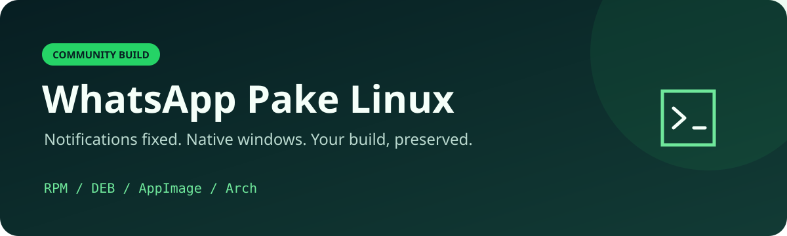

<p align="center"></p>

<p align="center">
  <a href="https://github.com/leogouveia/whatsapp-pake-linux/releases/latest"></a>
  <a href="https://github.com/leogouveia/whatsapp-pake-linux/actions/workflows/release.yml"></a>
  
  
</p>

# WhatsApp Pake Linux

WhatsApp Web em uma janela nativa, com **notificações corrigidas no GNOME**, **botão de fechar funcional no Wayland** e **DevTools habilitado**. Feito para instalar, reinstalar e recompilar sem perder as correções.

> Projeto comunitário e não oficial, baseado no [Pake](https://github.com/tw93/Pake). Não é afiliado ao WhatsApp ou à Meta. A interface e o serviço continuam sendo o WhatsApp Web; este projeto cuida do empacotamento e da integração com Linux.

**[Baixar instaladores](https://github.com/leogouveia/whatsapp-pake-linux/releases/latest)** · **[Build do zero](docs/BUILD.md)** · **[Diagnóstico e correções](docs/DIAGNOSTICS.md)** · **[Criar uma release](docs/RELEASING.md)** · **[Problemas comuns](docs/TROUBLESHOOTING.md)**

## Instalar

Baixe o arquivo para sua distribuição na página **Releases**. Os comandos abaixo pressupõem que o terminal está na pasta onde o arquivo foi baixado.

| Sistema | Formato | Instalação |
|---|---|---|
| Fedora 44 | `.rpm` | `sudo dnf install ./whatsapp-pake-linux-*-fedora44-x86_64.rpm` |
| Ubuntu 22.04+ / Debian compatível | `.deb` | `sudo apt install ./whatsapp-pake-linux-*-ubuntu22.04-x86_64.deb` |
| Arch / CachyOS atualizado | `.pkg.tar.zst` | `sudo pacman -U ./whatsapp-*-x86_64.pkg.tar.zst` |
| Outras distribuições compatíveis | `.AppImage` | Dê permissão de execução e abra o arquivo |

```bash
# AppImage: não exige instalação pelo gerenciador de pacotes
chmod +x ./whatsapp-pake-linux-*.AppImage
./whatsapp-pake-linux-*.AppImage
```

Instale somente o pacote escolhido para sua distro. Se já existir um pacote chamado `whatsapp`, confira sua origem: a atualização poderá substituí-lo. Encerre instâncias antigas pelo menu **Sair/Quit** antes de abrir a nova versão.

O menu de aplicativos mostra **WhatsApp**. O executável é `pake-whatsapp`.

## O que foi corrigido

| Problema | Correção local | Evidência |
|---|---|---|
| Notificação aceita pelo D-Bus, mas nenhum banner aparece | `notify-rust` reutiliza uma conexão de sessão que permanece viva | Banner sintético e mensagem real confirmados; remetente D-Bus vivo após 30 segundos |
| X da janela não responde até redimensionar | Tao deixa o GTK criar a decoração padrão no Wayland | X confirmado na primeira abertura e após ocultar/reabrir pela bandeja |
| Necessidade de investigar o aplicativo | DevTools ativo mesmo na compilação otimizada | Menu **View → Toggle Developer Tools**, atalho **Ctrl+Alt+I** |

Os testes interativos originais foram feitos em **CachyOS, GNOME Shell 51.1 e Wayland**, em 28/10/2026. Os builds de release verificam a compilação e o empacotamento em outros ambientes; isso **não substitui um teste visual em cada desktop**. Veja [a matriz de suporte](docs/BUILD.md#ambientes-e-compatibilidade).

## Comportamento da janela

- **X / Alt+F4:** oculta a janela e mantém o aplicativo recebendo mensagens.
- **Ícone da bandeja → Mostrar/Show:** reabre a janela.
- **Sair/Quit:** encerra o processo.
- **Ctrl+Alt+I:** abre ou fecha DevTools.

No GNOME, o ícone de bandeja depende de uma integração AppIndicator habilitada. DevTools fica disponível, mas não abre automaticamente.

## Reinstalar futuramente

1. Guarde o endereço deste repositório.
2. Instale a distro e suas atualizações.
3. Abra [Releases](https://github.com/leogouveia/whatsapp-pake-linux/releases), baixe o pacote correspondente e instale.
4. Abra o WhatsApp e vincule sua conta, se necessário.

Os instaladores não incluem conta, cookies, mensagens ou dados de sessão. Reinstalar o sistema pode exigir um novo vínculo pelo celular. A identidade `com.pake.ab7ae24` é mantida para preservar o perfil nas atualizações dentro do mesmo sistema.

Para conferir um download, coloque o instalador e `SHA256SUMS` na mesma pasta e compare:

```bash
sha256sum nome-do-arquivo-baixado
# Compare com a linha correspondente em SHA256SUMS.
```

## Compilar ou contribuir

```bash
git clone https://github.com/leogouveia/whatsapp-pake-linux.git
cd whatsapp-pake-linux
npm ci
npm run validate
# Após instalar Rust e as dependências da sua distribuição:
bash scripts/build.sh rpm       # Fedora
# bash scripts/build.sh deb
# bash scripts/build.sh appimage
# bash scripts/build.sh arch
```

Os arquivos são escritos em `out/`. As dependências modificadas estão incluídas em `vendor/`; **não é necessário aplicar patches manualmente**. Todas as instruções, dependências e detalhes do ambiente estão em [BUILD.md](docs/BUILD.md).

Uma tag `v<versão>` dispara builds separados para os quatro formatos. A automação publica a release somente quando todos terminam, incluindo fontes completos e hashes. Leia [RELEASING.md](docs/RELEASING.md) antes de publicar uma nova versão.

## Estrutura

```text
src-tauri/          Aplicativo Rust, configuração do WhatsApp e integração nativa
vendor/            notify-rust e Tao com as correções já aplicadas
patches/           Diffs pequenos para revisar as alterações nas dependências
scripts/           Build, pacote Arch, validações, fontes e checksums
.github/workflows/ CI e publicação automática de releases
docs/              Build, diagnóstico, manutenção e solução de problemas
web-assets/        Página local mínima; a janela carrega o WhatsApp Web
```

## Créditos e licença

Baseado no **Pake 3.17.7**, de Tw93 e contribuidores, com Tauri 2.10.2, plugin de notificações 2.3.3, notify-rust 4.12.0 e Tao 0.34.5. As versões Rust resolvidas estão fixadas em `Cargo.lock`; a CLI está fixada em `package-lock.json`.

O código derivado do Pake é distribuído sob [GPL-3.0-or-later](LICENSE), preservando a [Pake Output Exception](LICENSE-EXCEPTION). As dependências mantêm suas próprias licenças. Veja [THIRD_PARTY.md](THIRD_PARTY.md) e [a origem dos fontes](docs/PROVENANCE.md).
